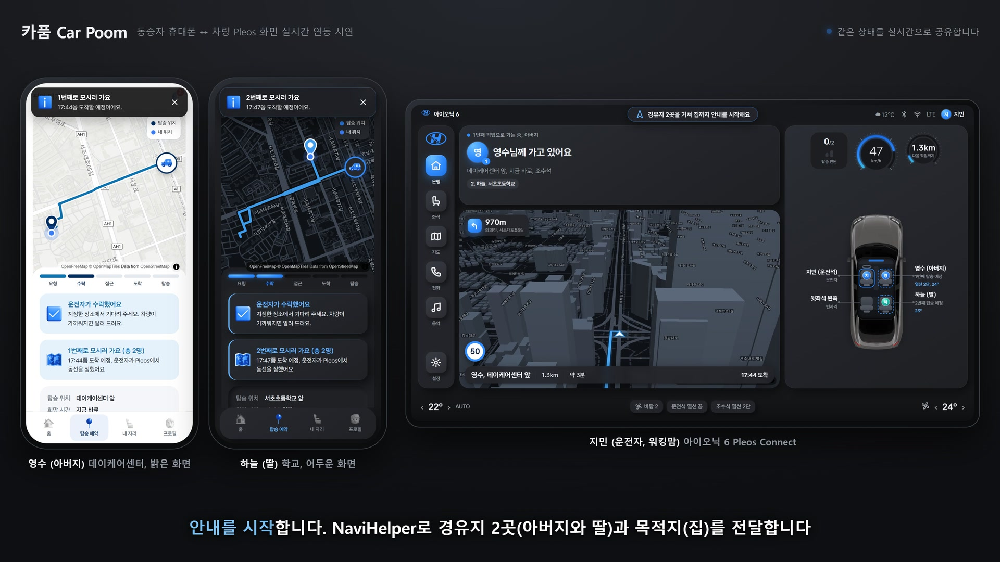

# 카품 (Car Poom)


시연 영상 맨 마지막에 나오는 화면입니다. 타원 안에 기울어진 H를 넣고, 그 위로 안전벨트처럼 휜 선이 지나가게 그렸습니다. 카품은 차(Car)와 품을 붙인 이름이라, 벨트 선도 H를 감싸 안는 모양으로 잡았습니다. 아래 적힌 티키타카(TikiTa_Car)가 저희 팀 이름입니다.

현대자동차그룹 차량용 앱 개발 공모전(Pleos Connect)에 낸 작품의 동작 시안을 이 저장소에 올렸습니다.

## 어떤 서비스인가요

남의 차를 얻어 탈 때 시트를 젖히거나 열선을 켜는 게 은근히 눈치 보입니다. 운전하는 사람은 운전대를 잡은 채로 "에어컨 좀 줄여 줄래?" 같은 부탁까지 챙겨야 하고요. 카품은 이 두 가지를 덜어 보려고 만들었습니다.

탈 사람이 휴대폰으로 어디서, 언제, 어느 자리에 탈지 보내면 운전자 차의 Pleos 화면에 요청이 뜹니다. 태울 사람이 여럿이면 누구부터 데리러 갈지 정해서 길을 안내합니다. 차에 탄 사람이 차량 화면에서 자기 이름을 누르면, 미리 저장해 둔 좌석 위치와 등받이, 열선, 공조, 창문 설정이 그 자리에 들어갑니다.



왼쪽 두 대가 동승자 휴대폰(아버지, 딸)이고 오른쪽이 운전자 차의 Pleos 화면입니다. 시연 영상은 이 화면을 실제로 조작하면서 녹화했습니다.

## 들어 있는 것

화면은 세 개이고, 모두 `carpoom-core.js` 하나를 같이 씁니다.

- `carpoom.html` 휴대폰 앱. 탑승 예약, 내 자리 설정, 운전자의 초대와 변경 권한 관리, Pleos QR 연결
- `pleos.html` 차량 화면(Pleos Connect, 16:9). QR 로그인, 픽업 수락, 순서 정하기, 길 안내, 좌석 배정, 탑승 확인과 설정 적용
- `stage.html` 위 사진처럼 휴대폰 두 대와 차량 화면을 한 화면에 띄워 서로 이어 주는 시연용 페이지

## 실행해 보기

`dist/` 폴더에 한 파일로 묶어 둔 결과가 있어서 설치 없이 브라우저로 열면 됩니다. `dist/stage.html`을 열고 차량 화면의 "지민님 휴대폰으로 스캔"을 누르면 시작합니다. 휴대폰 앱만 보려면 `dist/carpoom-standalone.html`, 차량 화면만 보려면 `dist/pleos-standalone.html`을 열면 됩니다.

지도와 Asta Sans 서체는 인터넷에서 받아 옵니다. 오프라인이면 단순한 지도와 내장 서체로 대신 나옵니다.

주소 뒤에 옵션을 붙일 수 있습니다. 휴대폰 앱은 `?user=u_youngsoo`(계정 고정), `?theme=dark` 또는 `light`, `?nosplash=1`을, 차량 화면은 `?vehicle=v_ioniq6b`, `?theme=light`를 받습니다.

## 고쳐 보려면

Node.js 18 이상이 있으면 됩니다.

```bash
npm install       # 테스트용 playwright-core, 코드 정렬용 prettier
npm run build     # dist/ 다시 만들기
npm test          # 빌드하고 테스트 세 묶음 실행
npm run video     # 시연 영상 녹화(ffmpeg 필요, demo/에 저장)
npm run format    # 코드 정렬
```

테스트는 세 묶음입니다. 권한, 예약 상태, 픽업 순서 같은 규칙 39개(`npm run test:core`), 휴대폰 앱 흐름 107개(`npm run test:ui`), 차량 화면과 연동 33개(`npm run test:pleos`)입니다. 브라우저 테스트는 설치된 Chrome을 Playwright로 띄웁니다. Playwright나 브라우저가 다른 곳에 있으면 `PLAYWRIGHT_PATH`, `CHROME_PATH`로 알려 주면 됩니다. 영상 녹화에는 ffmpeg가 필요하고, `FFMPEG_PATH`와 `DEMO_TIME`(화면 시각, 기본 17:40)을 쓸 수 있습니다.

## 시연 시나리오

지원서에 쓴 장면 그대로입니다. 퇴근한 워킹맘이 데이케어센터에 있는 아버지와 초등학교에 있는 딸을 태우고 집으로 갑니다. 아버지는 "지금 바로", 딸은 시간을 정해서 뒷좌석으로 요청합니다. 장소는 서울 서초동이고, 사람 이름과 차 번호판은 지어낸 것입니다.

데모 계정 셋을 바꿔 가며 볼 수 있습니다.

| 계정         | 누구         | 12가 3456 차                 | 34나 7890 차   |
| ------------ | ------------ | ---------------------------- | -------------- |
| `u_jimin`    | 운전자       | 주인                         | 주인           |
| `u_youngsoo` | 아버지       | 초대받음, 설정 변경 가능     | 초대 안 받음   |
| `u_haneul`   | 딸(초등학생) | 초대받음, 설정은 보기만 가능 | 설정 변경 가능 |

차를 두 대 넣은 건 권한이 차마다 따로라는 걸 보여 주려고서입니다. 딸은 첫째 차에서는 설정을 보기만 하고, 둘째 차에서는 직접 바꿀 수 있습니다. 어른 동승자도 같은 규칙을 따릅니다.

차는 Pleos 개발자 사이트(document.pleos.ai) 공식 디자인 가이드에 나오는 아이오닉 6로 맞췄습니다. 가이드에 들어 있는 차 그림이 모두 아이오닉 6라 이름과 이미지를 거기에 맞췄고, 휴대폰 좌석 화면의 반투명 차체도 아이오닉 6 크기(전장 4,855mm, 축거 2,950mm, 전고 1,495mm)로 그렸습니다.

## Pleos SDK는 어디에 쓰나

이 저장소는 웹으로 만든 동작 시안이라 SDK를 직접 부르지는 않습니다. 대신 실제 앱이라면 어떤 API를 부를지 차량 화면의 적용 내역에 같이 띄워 두었습니다. 공식 문서를 보고 정리하면 이렇습니다.

| 하는 일           | API                                                                                                        |
| ----------------- | ---------------------------------------------------------------------------------------------------------- |
| 좌석 앞뒤, 등받이 | `moveSeatForeAft`, `moveSeatBackrestAngle`(`MoveControl`), `getCurrentSeatXxxPosition`, `selectSeatMemory` |
| 열선, 통풍        | `setHvacSeatTemperature`, `setHvacSeatVentilation`                                                         |
| 자리별 공조       | `setHvacDual(false)` 다음 `setHvacTemperature(area)`, `setHvacFanSpeed`                                    |
| 창문              | `setWindowPosition(area)`                                                                                  |
| 누가 앉았는지     | `registerSeatOccupancy`, `getCurrentSeatOccupancy`                                                         |
| 차가 지원하는지   | `checkXxxCapabilities`, `AreaBounds`                                                                       |
| 경로와 경유지     | NaviHelper `requestRouteWithWaypoints`, `onWayPointArrived`                                                |
| 50m 앞 알림       | FusedLocation `addProximityAlert`(반경 50m, ENTER)                                                         |

문서를 읽다가 알게 된 제약도 반영했습니다.

- 시트와 차량 설정은 주행 중에 바꿀 수 없습니다. 그래서 설정은 차가 서 있을 때(탑승 확인 때)만 넣고, 달리는 동안에는 좌석 조정을 막았습니다.
- 좌석 위치와 등받이는 "몇 도로 맞춰라" 같은 절대값 API가 없습니다. 지금 위치를 보면서 목표까지 움직이거나 차량 메모리를 불러와야 합니다.
- NaviHelper는 경유지를 두 곳까지만 받습니다. 정류장이 더 많으면 한 곳에 도착할 때마다 다음 구간을 다시 요청합니다.
- 차량 제어 권한은 App Market 사전 승인이 필요합니다. 승인 전까지는 에뮬레이터와 Virtual Console에서 확인합니다.

## 아직 흉내만 낸 부분

시연이 끊기지 않게 서버 없이 한 기기 안에서 돌아가도록 만들었습니다. 실제 서비스로 가려면 아래를 바꿔야 합니다.

- 화면끼리 상태를 주고받는 부분은 지금 브라우저 안(postMessage, BroadcastChannel, localStorage)에서만 오갑니다. 실제로는 서버와 푸시가 맡습니다.
- 지도는 OpenFreeMap 타일과 미리 받아 둔 경로를 쓰고, 나머지 경로는 OSRM 공개 서버에 묻습니다. 실제로는 Pleos NaviHelper와 모바일 지도 SDK를 씁니다.
- 지도 위 차는 경로를 따라 움직이는 가짜 차입니다. 실제로는 FusedLocation 위치를 씁니다.
- 좌석 감지와 설정 적용은 화면에 표시만 합니다. 실제로는 Vehicle SDK가 합니다.
- 본인과 나이 확인, 앱 통화, 푸시 알림은 모양만 있고 진짜로 인증하거나 연결하지 않습니다.

## 폴더

```
├─ carpoom.html        휴대폰 앱
├─ pleos.html          차량 화면(1600×900으로 그리고 창 크기에 맞춰 늘이고 줄임)
├─ stage.html          시연 페이지(휴대폰 두 대와 차량 화면을 iframe으로 연결)
├─ carpoom-core.js     권한, 설정, 예약 상태, 희망 시간, 픽업 순서, 좌석 배정, 탑승 확인, QR
├─ carpoom-geo.js      지도 계산(시나리오 장소와 경로, 회전 안내, 거리)
├─ carpoom-sync.js     화면끼리 상태와 차 위치 주고받기
├─ carpoom-brand.js    엠블럼(세 화면이 같이 씀)
├─ build.js            한 파일로 묶어 dist/에 저장
├─ dist/               묶은 결과(바로 실행용)
├─ docs/images/        이 문서에 쓴 이미지
├─ assets/             서체, 아이콘, 차량 이미지, three.js, MapLibre, LICENSES.txt
├─ tools/              아이콘 만드는 스크립트
└─ test/               테스트와 영상 녹화 스크립트
```

## 가져다 쓴 것

출처와 라이선스 전문은 [`assets/LICENSES.txt`](assets/LICENSES.txt)에 있습니다.

- Asta Sans: Pleos Connect 기본 서체. SIL OFL 1.1
- Pretendard 1.3.9: 인터넷이 없을 때 쓰는 서체(필요한 글자만 남긴 사본). SIL OFL 1.1
- MapLibre GL JS 5.6.0: 지도 그리기. BSD-3-Clause. 한글 도로명이 세로로 눕지 않게 한 줄을 고쳤습니다.
- OpenFreeMap, OpenMapTiles, OpenStreetMap: 지도 타일과 데이터. ODbL 1.0
- OSRM 공개 서버: 경로 계산. 데이터 © OpenStreetMap contributors
- three.js r128: 휴대폰 앱의 3D 좌석. MIT
- Microsoft Fluent Emoji 3D: 휴대폰 앱 아이콘(블루 톤으로 다시 칠함). MIT
- Pleos 디자인 가이드 차량 이미지: 차량 화면의 차 그림. 현대자동차그룹 자료이며 공모전 시연에만 씁니다.
